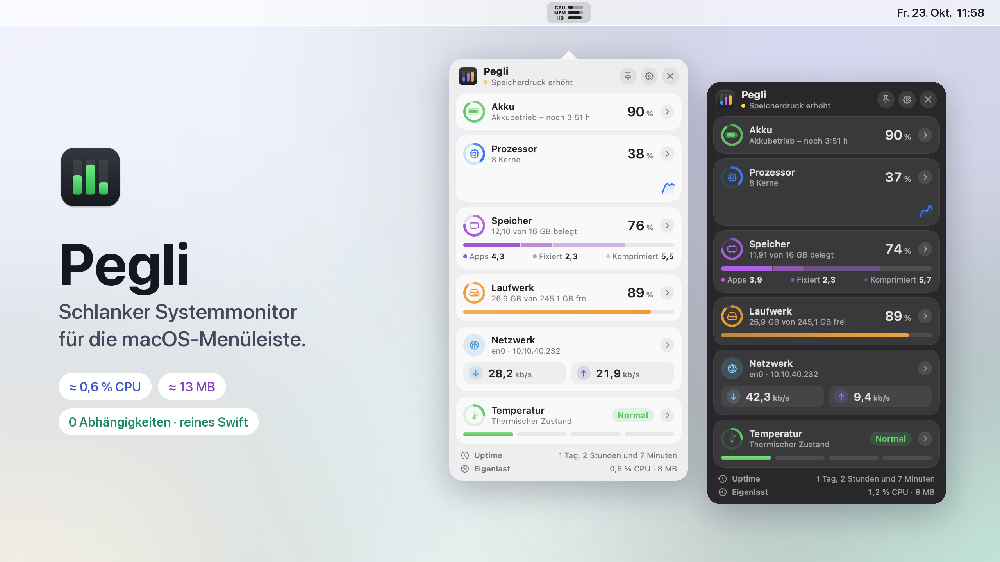
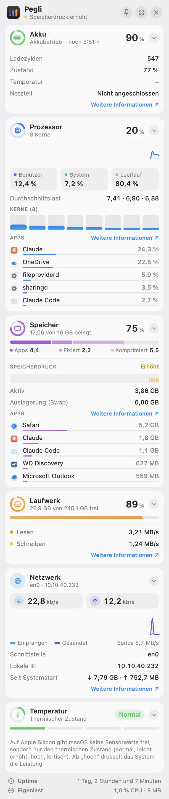
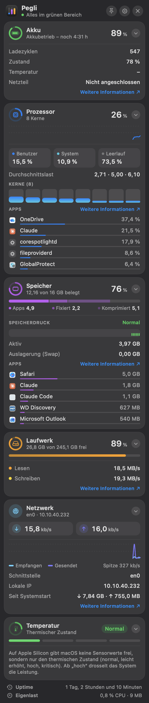

<div align="center">



# Pegli

**Your Mac at a glance — a lean system monitor for the macOS menu bar.**<br>
Pure Swift, zero dependencies, ≈ 0.6 % CPU and ≈ 13 MB of memory.

[](https://github.com/hannokuegler/pegli/releases/latest)
[](https://github.com/hannokuegler/pegli/actions/workflows/ci.yml)
[](LICENSE)


[Deutsch](README.md) · **English**

</div>

```bash
curl -fsSL https://raw.githubusercontent.com/hannokuegler/pegli/main/install.sh | bash
```

<sub>One command: downloads the latest release, verifies its SHA-256 checksum, installs to `~/Applications`, sets up autostart and launches Pegli. Other options: [Installation](#installation).</sub>

> [!NOTE]
> The app's interface is in German (numbers in `de_DE` format). The labels are short and self-explanatory — Akku = battery, Prozessor = CPU, Speicher = memory, Laufwerk = disk, Netzwerk = network.

## What Pegli shows

The menu bar icon shows **CPU, memory and boot volume** as three tiny bars. A click opens the panel; every section expands with its arrow:

| Section | Overview | Expanded |
|---|---|---|
| 🔋 **Battery** | Level, charging / on battery, time remaining | Cycle count, health, temperature, adapter wattage |
| 🧠 **CPU** | Total load, history | User/system/idle, load average, per-core load, top 5 apps |
| 🧩 **Memory** | Used, split into apps / wired / compressed | Memory pressure with history, active, swap, top 5 apps |
| 💾 **Disk** | Boot volume, other volumes (collapsible) | Read / write rate |
| 🌐 **Network** | Down / up | History, interface, local IP, totals since boot |
| 🌡️ **Temperature** | Thermal state in 4 levels | What the levels mean |

Plus uptime and Pegli's own load in the footer; "Weitere Informationen ↗" opens the matching system app (Activity Monitor, Disk Utility, battery settings). Top apps are grouped like Activity Monitor does — helpers and Safari tabs count towards their app.

<p align="center">
  
  &nbsp;&nbsp;
  
</p>

**Controls:** pin keeps the panel open · gear for interval (1 / 2 / 5 s), launch at login and quit · X or Esc closes · right-click the icon for a quick menu. Expanded sections and the interval are remembered.

## 🪶 Featherweight

A system monitor that creates load mostly measures itself. Pegli is built to stay out of the way:

| | Pegli |
|---|---|
| **CPU** on average | **≈ 0.6 %** of one core |
| **Memory** (footprint, as in Activity Monitor) | **≈ 13 MB** |
| **App size** | 1.7 MB (0.8 MB download) |
| **Dependencies** | none, Apple frameworks only |

<sub>Measured over 5 minutes with [`scripts/measure.sh`](scripts/measure.sh) on a MacBook Pro M1 (16 GB), panel closed, 2 s interval. CPU is derived from CPU time actually consumed, not from momentary readings.</sub>

**How Pegli gets there**

- **Measuring is cheap, drawing is expensive.** All sensors together cost only ≈ 0.1 % CPU. The rest is macOS updating the menu bar icon — about 20 ms per update. So Pegli only redraws when a bar changes **visibly** (≈ 1 pt) and smooths CPU load for the icon over a few seconds. The panel still shows exact values. Result: half the CPU of before (1.3 % → 0.6 %) and a calm icon that doesn't flicker.
- **Process list only while the panel is open.** Top apps — the most expensive measurement — run only while you're looking.
- **No SwiftUI while idle.** The panel is built on open and thrown away on close.
- **Volumes only every 10th tick**, everything else straight from Mach, IOKit and `sysctl` — no helper processes, no polling of command-line tools.

Pegli shows its own load at the bottom of the panel. Measure it on your Mac:

```bash
git clone https://github.com/hannokuegler/pegli.git && pegli/scripts/measure.sh
```

## Installation

**Requirements:** Apple Silicon Mac, macOS 14 (Sonoma) or newer.

**1. Terminal (recommended)** — the command above. Run it again to update.

**2. From source** — only needs the Command Line Tools (`xcode-select --install`):

```bash
git clone https://github.com/hannokuegler/pegli.git
cd pegli
./scripts/install.sh
```

**3. By hand** — download `Pegli-macOS.zip` from the [latest release](https://github.com/hannokuegler/pegli/releases/latest) and drag `Pegli.app` into `~/Applications`. Pegli is ad-hoc signed, not notarized: macOS blocks the first launch — click **"Open Anyway"** under **System Settings › Privacy & Security**. Then enable autostart in the gear menu.

## Uninstall

```bash
curl -fsSL https://raw.githubusercontent.com/hannokuegler/pegli/main/scripts/uninstall.sh | bash
```

Stops the autostart and removes `~/Applications/Pegli.app` and the LaunchAgent. Settings stay; remove them with `defaults delete local.hanno.pegli`.

## Under the hood

Autostart is a plain LaunchAgent (`~/Library/LaunchAgents/local.hanno.pegli.plist`) with `RunAtLoad`, restart after a crash but not after quitting, and a single-instance guard. Status: `launchctl print gui/$(id -u)/local.hanno.pegli` · Log: `~/Library/Logs/Pegli.log`.

Architecture, test flags (`--dump`, `--render`) and release process: [docs/ENTWICKLUNG.md](docs/ENTWICKLUNG.md) (German). Changes: [CHANGELOG.md](CHANGELOG.md).

## License

[MIT](LICENSE) © 2026 Hanno Kügler — take it, remix it, share it.
